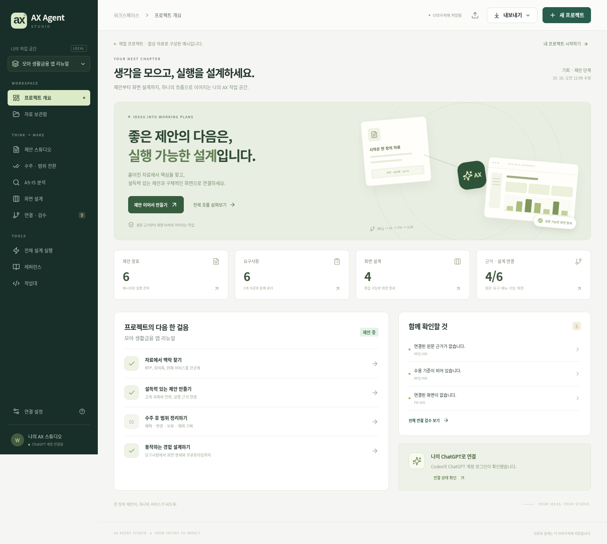

# AX Agent Studio

자료를 모아 제안서를 만들고, 수주 후 요구사항과 화면 설계로 이어 가는 개인용 작업 공간입니다. 프로젝트 안에서 **자료 → 제안 → 범위 결정 → AS-IS 분석 → REQ·IA·FN·SCR → 연결 검수**를 관리합니다. 화면과 산출물은 직접 편집할 수 있고, AI 생성은 같은 컴퓨터의 Codex CLI에 로그인한 ChatGPT 계정을 사용합니다.

**[실행용 소스 ZIP 다운로드](https://github.com/parkh37t/AX-Agent_Codex/raw/refs/heads/codex/ax-agent-studio/downloads/ax-agent-studio.zip)** · [연결 안내](docs/authentication.md) · [제품 명세](docs/product-spec.md) · [벤치마크 근거](docs/benchmark.md) · [검증 기록](docs/validation.md)

ZIP은 설치 프로그램이 아닌 소스 묶음입니다. 압축을 푼 폴더에서 아래 명령을 실행하세요. **현재 공개 사이트는 배포되지 않았습니다.** GitHub 페이지는 코드·문서·파일을 제공하며, 아래 로컬 주소는 실행한 컴퓨터에서만 열립니다.

## 스킬·설정·지식 이어서 사용

**[전체 스킬·MD ZIP 다운로드](https://github.com/parkh37t/AX-Agent_Codex/raw/refs/heads/codex/ax-agent-studio/downloads/ax-agent-studio-skills-md.zip)** · [통합 지식 MD](https://github.com/parkh37t/AX-Agent_Codex/raw/refs/heads/codex/ax-agent-studio/downloads/AX-AGENT-KNOWLEDGE.md) · [시작 안내](START-HERE.md)

AX 개발·실행 스킬과 Wylie 제안서 제작 스킬, 실제 설정 스냅샷, 폰트·도식·레이아웃 규칙, 재개 프롬프트와 검증 기록을 함께 제공합니다. ChatGPT에서는 통합 MD를 파일로 올리고 [프로젝트 지침](docs/PROJECT-INSTRUCTIONS.md)을 지침에 복사하세요. 코딩 도구에서는 `.agents/skills/`의 두 폴더 전체를 사용하세요. [모든 설정](docs/PROJECT-SETTINGS.md) · [인수인계](docs/CONTINUE-HERE.md) · [무결성 해시](downloads/AX-AGENT-SKILLS-SHA256SUMS).

묶음은 인증·브라우저 데이터를 이전하거나 사이트를 배포하지 않습니다. **전체 앱 소스 checkout에서** `python scripts/package_knowledge.py`로 현재 문서와 스킬에서 단일 MD·스킬 ZIP·소스 ZIP을 다시 만들 수 있습니다.



## 실행

Node.js **22.12 이상**, npm, Codex 이용 권한이 있는 ChatGPT 계정이 필요합니다. Node·Codex·앱을 같은 운영체제 환경과 사용자 계정으로 실행하세요. Windows에서는 WSL2 사용을 권장합니다.

```sh
npm ci
npm run codex:login
npm run codex:status
npm run dev
```

`npm ci`가 프로젝트에 고정된 공식 Codex CLI **`0.162.1`**도 설치합니다. 위 로그인·상태·실행 명령은 이 로컬 CLI를 사용합니다. Codex의 공식 로그인 창에서 ChatGPT 계정으로 로그인한 뒤 **[http://127.0.0.1:5173](http://127.0.0.1:5173)**을 엽니다. 이미 원하는 계정으로 로그인되어 있으면 로그인 명령은 생략할 수 있습니다. 브라우저의 ChatGPT 로그인과 CLI 로그인은 별개입니다.

이 구현은 `--ignore-user-config`, `--ephemeral`, 구조화 출력 등의 CLI 옵션에 의존합니다. 공식 npm stable **`0.162.1`**에서 필수 옵션과 기능 목록 지원을 확인했습니다. 초기 클라우드 환경의 CLI는 `0.159.0-alpha.3`이었으며 앱의 설치 버전과 구분합니다. 향후 다른 버전의 자동 호환을 보장하지 않습니다.

**실제 AI 생성 검증은 아직 완료되지 않았습니다.** 클라우드에서는 ChatGPT 로그인 상태를 확인했지만, 읽기 전용 `CODEX_HOME`에 `installation_id`를 만들지 못해 모델 작업 시작 전에 실패했습니다. 사용자 로컬 PC의 실제 계정으로 추론이 완료되는지는 추가 확인이 필요합니다. 연결 절차와 제한은 [연결 안내](docs/authentication.md)에 있습니다.

빌드한 앱을 실행하려면 다음 명령을 사용합니다.

```sh
npm run build
npm start
```

이 경우 **[http://127.0.0.1:4318](http://127.0.0.1:4318)**에서 사용합니다. 서버는 개인 컴퓨터의 loopback 주소에 바인딩됩니다.

API 키를 입력하는 앱이 아닙니다. ChatGPT 플랜에 포함된 Codex 사용량을 사용하며, 플랜별 이용 범위와 사용량 제한은 [공식 플랜 안내](https://help.openai.com/en/articles/11369540-codex-in-chatgpt)를 확인하세요. 인증 방식은 [공식 Codex 인증 문서](https://developers.openai.com/codex/auth)를 따릅니다. 생성 시 프로젝트 자료는 Codex를 통해 OpenAI로 전송됩니다.

## 사용 흐름

1. **프로젝트와 자료를 등록합니다.** 목표를 적고 RFP·회의록·현행 자료를 붙입니다. TXT·MD·CSV·JSON·DOCX·PDF·PPTX에서 텍스트를 추출하고 읽은 범위와 한계를 기록합니다.
2. **제안을 구성합니다.** 핵심 전략과 장표의 제목·메시지·근거를 편집하고 PPTX로 내보냅니다. AI 결과는 검토 후 프로젝트에 반영합니다.
3. **수주 후 범위를 정리합니다.** 모든 요구사항에 채택·변경·보류·제외와 이유를 적어 수행 단계로 전환합니다. 문서 주장과 가설은 그대로 구분합니다.
4. **현행 분석과 화면을 설계합니다.** AS-IS 개선 제안을 출처가 이어지는 요구사항 초안으로 전환하고, REQ·IA·FN·SCR을 편집합니다. 들여쓴 메뉴로 규칙 기반 초안을 만들고 화면의 역할·입력 필드·규칙·상태를 검토합니다.
5. **연결을 점검하고 내보냅니다.** 누락된 출처와 ID 연결을 확인하고 PPTX·Markdown·CSV·오프라인 HTML·JSON을 다운로드합니다.

처음 표시되는 모아금융 프로젝트는 **가상 고객과 합성 자료로 만든 체험 예시**입니다. 체험과 메뉴 기반 초안은 실제 AI 추론 결과가 아닙니다. 출처 누락과 화면 상태 누락을 포함해 검수 흐름도 체험할 수 있습니다.

## 저장과 현재 범위

프로젝트는 브라우저 `localStorage`에 저장됩니다. 주요 변경 전 스냅샷은 프로젝트별 최근 **8개**를 보관하며, 작업대에서 복원할 수 있습니다. 스냅샷 보관에 실패하면 해당 변경을 중단합니다. 손상된 저장 데이터는 원본을 별도 복구 백업으로 보존한 뒤 유효한 프로젝트를 복구하며, 원본 보존에 실패하면 저장을 중단합니다. 다른 브라우저·컴퓨터로 옮길 때는 JSON 백업을 사용하세요. JSON 가져오기는 기존 프로젝트를 덮어쓰지 않고 새 프로젝트를 만듭니다.

생성 작업 ID는 같은 탭의 `sessionStorage`에 기록해 새로고침 후 서버 작업 상태를 다시 확인합니다. 서버를 재시작하면 메모리의 작업 상태가 사라지므로 이어할 수 없습니다. AI 결과는 현재 프로젝트의 참조를 다시 검사한 뒤 반영합니다. AI 또는 수동 편집으로 요구사항이 변경되면 기존 수행 범위 결정은 재확인이 필요합니다.

현재는 텍스트 기반 분석과 편집 가능한 초안 제작을 지원합니다. OCR, URL 방문·실사, 다중 사용자 협업, 서버 DB, 정식 계약 승인·전자서명은 제공하지 않습니다. PPTX는 편집 가능한 비교·전략·프로세스·로드맵·근거 도식을 제공하며, 내용이 길면 텍스트 장표로 나누어 담습니다. 학습 자료의 장표를 픽셀 단위로 재현하지 않습니다. HTML의 상태 전환·목록 검색·필수 입력 확인은 예시 동작이며 실제 업무 시스템에 연결되지 않습니다.

구조 검수 통과와 사실 검증·요구사항 충족·고객 승인은 서로 다릅니다. 구현 범위와 데이터 모델은 [제품 명세](docs/product-spec.md)를 참고하세요. 문서 기준일은 **2026-10-10, Asia/Seoul**입니다.

## ChatGPT용 와일리 제안서 스킬

앱과 별도로, 제안서의 구성·콘텐츠·폰트·도식·레이아웃 제작 방법을 ChatGPT 프로젝트 또는 맞춤 GPT에서 활용할 수 있도록 정리한 자료입니다.

### 다운로드

**[ChatGPT용 전체 묶음 ZIP 다운로드](https://github.com/parkh37t/AX-Agent_Codex/raw/refs/heads/main/downloads/wylie-proposal-chatgpt.zip)**

ZIP에는 통합 지식 파일, 사용 지침, 시작 안내, 편집 가능한 12종 PPTX 템플릿, PDF와 미리보기 이미지가 들어 있습니다. 무결성 확인용 해시는 [SHA256SUMS](https://github.com/parkh37t/AX-Agent_Codex/blob/main/downloads/SHA256SUMS)에 있습니다.

### 사용 방법

1. ZIP을 다운로드하고 압축을 풉니다.
2. `wylie-proposal-knowledge.md`를 ChatGPT 프로젝트 파일 또는 맞춤 GPT의 Knowledge에 업로드합니다.
3. `instructions.txt` 내용을 프로젝트 지침 또는 GPT Instructions에 붙여 넣습니다.
4. 같은 프로젝트/GPT에서 RFP와 고객 자료를 첨부하고 “와일리 제안서 제작 방식을 적용해줘”라고 요청합니다.

자세한 방법은 묶음 안의 `START-HERE.md`를 참고하세요. Codex와 ChatGPT 사이에 자동 동기화되거나 모델 자체가 재훈련되는 방식은 아닙니다.

### 분석 범위

제공된 29개 파일 중 16개 유효 문서를 분석했습니다. PPTX 593장, PDF 176쪽, DOCX 2개이며 판본 중복을 포함합니다. 12개는 전송 한도로 미열람, 1개는 본문 없는 메타데이터였습니다. 원본 고객 문서 전체와 폰트 바이너리는 포함하지 않았습니다. 관측한 스타일·출처·요약된 방법과 새로 만든 템플릿을 포함합니다.
