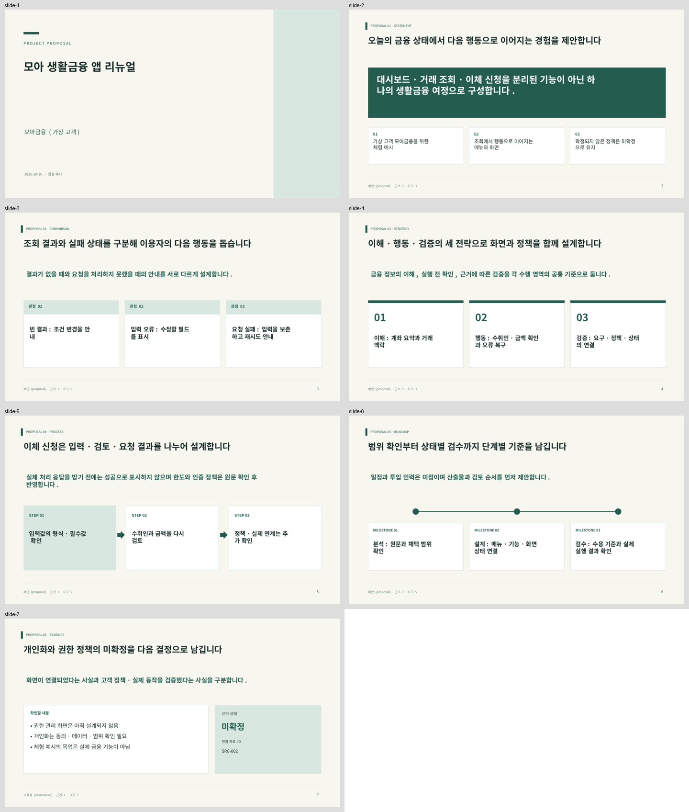

# 검증 기록

기준: 2026-10-10. Linux, Node.js 24.19.0, npm 11.9.0, Chromium. 설치 최소 버전은 Node.js 22.12이며 이 기록의 실제 실행 버전과 구분합니다.

## 실행한 검사

| 항목 | 결과 | 확인 범위 |
|---|---|---|
| `npm ci --cache /workspace/.cache/npm --no-audit --no-fund` | 통과 | 잠금 파일 기반 의존성 250개 재설치, 공식 Codex 0.162.1 포함 |
| `npm run build` | 통과 | 전체 TypeScript 검사 및 Vite 배포 번들 |
| `npm test` | 120개 통과 / 6개 파일 | 자료 추출 34, 저장·복구 35, 서버·인증 18, 내보내기 18, 도메인 10, 범위 변경 5 |
| 마지막 PPTX 줄바꿈 보정 후 재검사 | 통과 | 내보내기 18개와 전체 타입 검사·빌드 재실행 |
| Playwright | 10개 항목 통과 | 전체 실행 9개 통과, 개발 서버 재시작으로 중단된 작업 복구 1개는 서버 안정 후 별도 재실행 통과 |
| 프로덕션 `npm start` | 통과 | 실제 빌드 HTML HTTP 200, 공식 CLI 상태 조회, 브라우저 콘솔 오류 0 |
| 수행 범위 변경 브라우저 확인 | 통과 | 모든 요구 채택 → 요구 1개 수정 → 해당 결정만 재검토 상태, 다른 결정 유지 |
| PPTX 실제 파일 렌더링 | 통과 | 브라우저 다운로드, LibreOffice PDF 변환, 합성 데모 7장 전체 한글·잘림·겹침 시각 검토 |

Playwright는 12개 화면의 데스크톱·모바일 390px 탐색, 프로젝트 생성, 자료 등록, 메뉴→화면, 명세 수정, 폼 동작, JSON·HTML·PPTX 다운로드, 잘못된 가져오기 거부, 손상 원본 복구 다운로드, 프로젝트 간 편집 격리, 입력 한도, AI 결과 검토·반영·복원, 같은 탭 작업 복구를 확인합니다. 브라우저 자동 테스트의 AI 응답은 명시적인 테스트 대역이며 실제 모델 호출이 아닙니다.

실제 자료 추출 경로에서는 별도로 PPTX 90장·43,666자 텍스트 추출을 확인했습니다. 원본 고객 자료는 이 저장소와 앱 ZIP에 포함하지 않았습니다. PPTX 렌더링은 LibreOffice 기준이며 Microsoft PowerPoint 데스크톱과 모든 글꼴 환경은 미검증입니다. 긴 본문 분할과 편집 가능한 도형·텍스트는 OOXML 구조 검사로도 확인했습니다.



## 실제 AI 생성은 미검증

현재 클라우드의 공식 Codex `0.162.1` 상태는 `authenticated: true`, `authMode: chatgpt`, `generationReady: false`입니다. 초기 설치 CLI의 작은 합성 요청은 읽기 전용 상태 저장 경로 때문에 모델 이벤트 시작 전에 실패했습니다. 안정판에서는 옵션·기능·인증·저장 권한 메타데이터까지만 확인했습니다. 실제 계정으로 생성 완료, 구독 사용량 청구, 응답 품질을 확인한 것으로 해석하지 않습니다.

앱은 이 상태를 연결 설정에 표시하고 생성을 차단합니다. 사용자 PC의 정상적인 Codex 환경에서 실제 생성 완료 검증이 남아 있습니다. 자세한 원인과 공식 연결 방법은 [인증 안내](authentication.md)를 참고하세요.

## 재실행

```sh
npm ci
npm test
npm run build
npm run test:e2e
```

브라우저 테스트에는 Chromium이 필요합니다. 관리형 환경의 설치된 브라우저를 자동 탐색하며, 다른 컴퓨터에서는 Playwright의 일반 브라우저 설치 절차를 사용하거나 `PLAYWRIGHT_CHROMIUM_PATH`를 지정할 수 있습니다. 테스트가 시작하는 서버와 실제 앱 서버의 포트 충돌을 피하세요.
